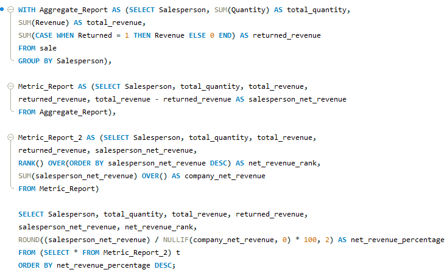
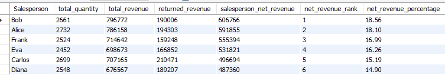
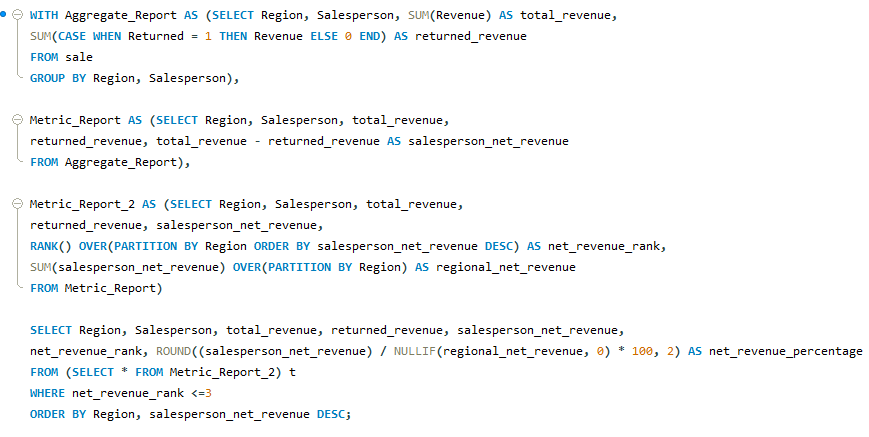
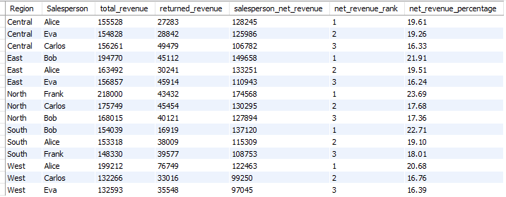

# 1. Salesperson Revenue Analysis

## Business Question 1

Which salesperson contributes the most to the company's net revenue, and how does their sales volume compare with their revenue performance?

### SQL Query

### Query Result

### Observation 1

- Bob ranked as the highest-performing salesperson, generating the highest total revenue and net revenue. Consequently, he contributed the largest percentage share of the company's net revenue.
- Despite not recording the highest quantity sold, Bob generated the highest net revenue, demonstrating that higher sales volume does not necessarily translate into higher revenue.

---

## Business Question 2

How much does each salesperson contribute to their respective region's net revenue, and who are the top-performing salespeople within each region?

### SQL Query

### Query Result

### Observation 2

- Based on regional net revenue contributions and rankings, Alice ranked as the highest-performing salesperson in the Central and West regions. Bob ranked highest in the East and South regions, while Frank ranked highest in the North region.
- Notably, among the highest-performing salespeople across the five regions, Frank generated the highest net revenue in the North region, outperforming the top-ranked salespeople in the other regions.

---

## Interpretation

The results across Tables 1 and 2 imply that salesperson revenue performance varies at both the company-wide and regional levels.

Furthermore, the results suggest that while quantity sold provides valuable context for interpreting revenue performance, it is not the sole determinant.

Despite not recording the highest quantity sold, Bob emerged as the company's highest revenue-generating salesperson, contributing the largest percentage share of its net revenue. This demonstrates that higher sales volume does not necessarily translate into higher revenue. Similarly, Frank's performance in the North region distinguished him among the top-performing salespeople across the five regions.
