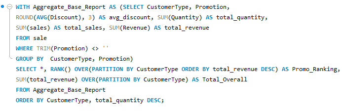
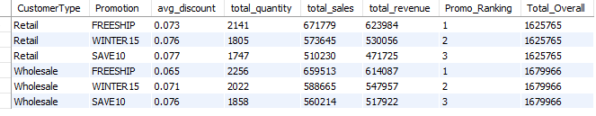

# 2. Customer Type – Promotion Analysis

### Business Question
How does promotion usage affect sales, revenue, quantity sold, and discount levels across customer types?

### SQL Query

### Query Result

### Key Observations
1. Free-Ship promotion ranked as the most effective promotion (1st) across both customer types (Wholesale and Retailer), followed by Winter 15 (2nd).

2. Free-Ship promotion recorded the highest sales and revenue across both customer types, followed by Winter 15, despite Free-Ship having the lowest average discount.

### Interpretation
Free-shipping promotion represents an incentive in which customers are not charged shipping fees.

Across both customer types, the results indicate that Free-Ship was the most effective promotion in terms of sales performance, followed by Winter 15. This suggests that removing shipping fees may make purchases more attractive to customers and potentially encourage higher order volumes.

Furthermore, Free-shipping achieved strong sales and revenue performance despite recording the lowest average discount across customer types. This suggests that free shipping may have served as an effective purchasing incentive without requiring substantial price discounts.
