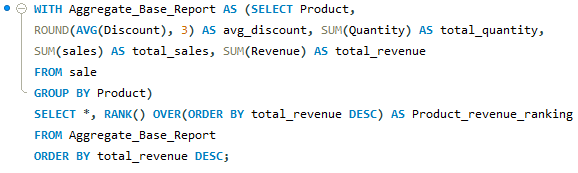
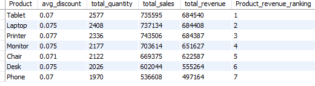
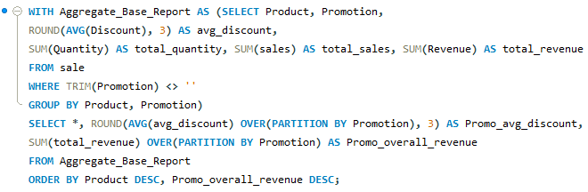
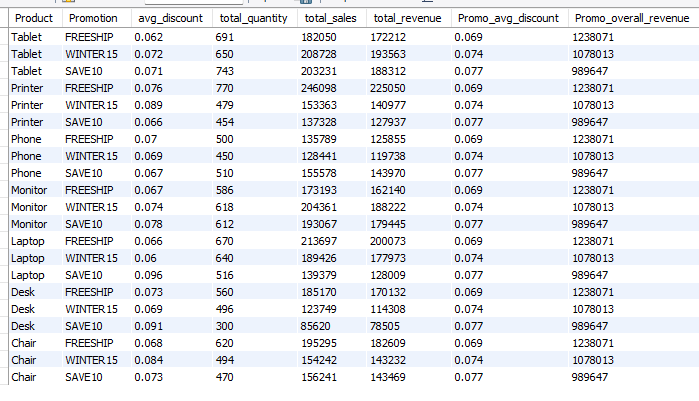

# 3. Product and Product-Promotion Analysis

## Business Question 1: Product Performance Analysis

### Business Question
Which products generated the strongest sales and revenue performance, and how does this compare with their discount levels?

### SQL Query

### Query Result

### Key Observations
Despite recording one of the lowest average discounts, alongside Phone, Tablet ranked as the top-performing product in terms of sales and revenue, contributing the highest revenue to the company's overall revenue.

---

## Business Question 2: Product-Promotion Analysis

### Business Question
How do different promotions affect sales, revenue, quantity sold, and discount levels across products?

### SQL Query

### Query Result

### Key Observations
1. Free-Ship generated the highest revenue for Printer, Laptop, Desk, and Chair, despite recording the lowest average discount across the products.

2. Winter 15, with the second-lowest average discount, generated the highest revenue for Tablet, while Save 10 generated the highest revenue for Phone.

### Interpretation
Product performance is not necessarily determined by the size of the discount offered. The results demonstrate the importance of evaluating promotional effectiveness alongside product-level sales and revenue performance.

Overall, the results indicate that Free-Ship was the most effective promotion in terms of revenue performance across the products, followed by Winter 15 and Save 10, respectively.
