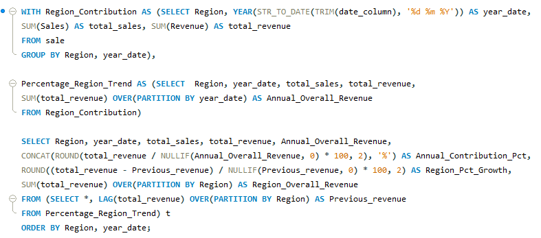
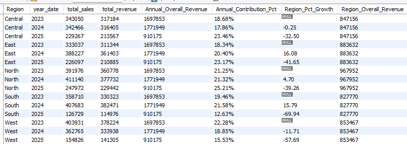

## 4. Annual – Region Revenue Analysis

## SQL Query

## Query Result

## Question 1

### Business Question:

Which year did each region generate its highest revenue?

## Key Observation

Across the three observed years (2023–2025), the South, East, and North regions recorded their highest revenue in 2024. In contrast, the West and Central regions recorded their highest revenue in 2023.

---

## Question 2

### Business Question:

Which region recorded the highest annual revenue contribution for each year, and which region contributed the largest share overall?

## Key Observation

Across the regions, the North region recorded the highest percentage contribution to company revenue in 2025, reflecting its stronger revenue performance relative to other regions in the same year. Meanwhile, the South and West regions recorded the highest contributions in 2024 and 2023, respectively.

Notably, the North region also recorded the highest average annual percentage contribution to company revenue across the three-year period (2023–2025), at **22.10%**.

---

## Interpretation

Over the observed years (2023–2025), a lower annual contribution percentage for a region does not necessarily indicate lower regional revenue. Instead, it indicates that the region accounted for a smaller share of the company's total annual revenue for that particular year.

One possible explanation is that the region's revenue grew more slowly than the company's overall annual revenue, perhaps because other regions experienced stronger revenue growth. Consequently, the region recorded a lower annual contribution percentage relative to other observed years.
