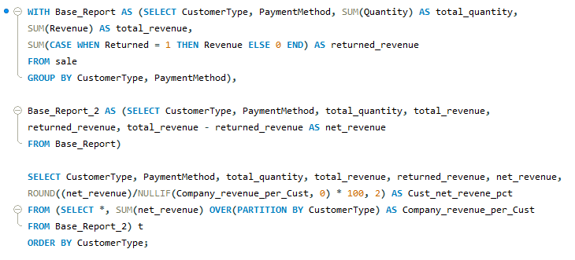
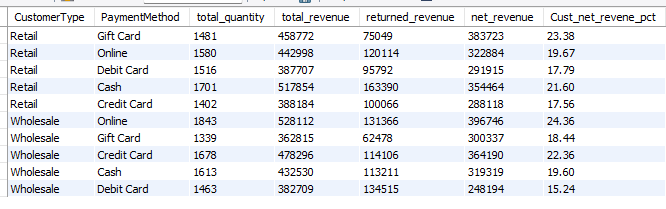

# 5. Customer Type – Payment Type Analysis

## SQL Query

## Query Result

---

## Question 1

### Business Question:

Which payment method recorded the strongest net revenue performance within each customer category, and what was its strongest contributing factor?

## Key Observations

- **Retailer:** Gift Card payments recorded the highest net revenue, alongside the lowest return losses, making them the strongest-performing payment method within this customer category.

  One possible explanation is that customers using gift cards may make more deliberate purchasing decisions due to their flexibility, potentially contributing to lower return losses. However, this explanation remains speculative because the available data does not establish the reason.

- **Wholesaler:** Online payments recorded the highest net revenue, supported by the highest total revenue and sales volume, despite also recording relatively high return losses. Total revenue was the strongest contributing factor.

  One possible explanation is that online payments may make large-quantity purchases more convenient, potentially encouraging customers to purchase larger quantities and contributing to higher revenue. However, this explanation remains hypothetical, as the available data does not establish a typical reason.

---

## Question 2

### Business Question:

How do sales volume, return losses, and total revenue relate to net revenue across customer categories and payment methods?

## Key Observations

- **Retailer:** Gift Card payments achieved the highest net revenue because high total revenue and the lowest return losses outweighed the lower sales volume. The lowest return losses were the strongest contributing factor.

- **Wholesaler:** Online payments achieved the highest net revenue because the highest total revenue and sales volume outweighed the relatively high return losses. Total revenue was the strongest contributing factor.

## Interpretation

The results across the Retailer and Wholesaler customer categories indicate that the highest net revenue does not necessarily coincide with the highest sales volume.

Notably, total revenue and return losses can contribute independently or jointly to net revenue, and neither must individually achieve the most favourable ranking for a combination to achieve the highest net revenue.

This relationship follows the principle that, all else being equal, higher total revenue and lower return losses lead to higher net revenue.
