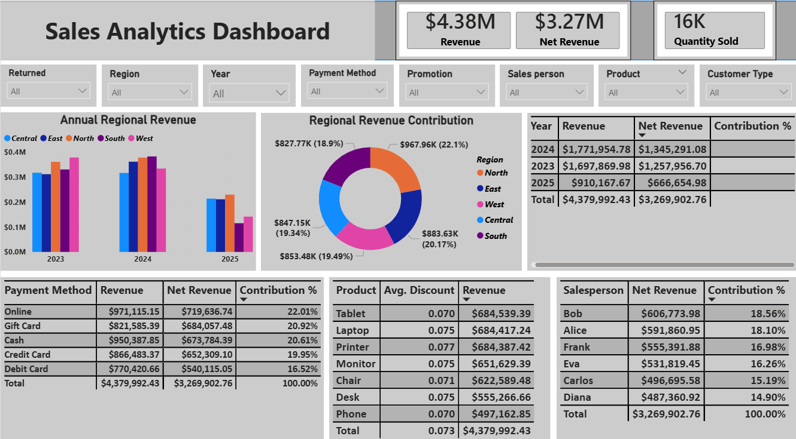

# Sales Performance and Business Intelligence Analysis

**Project Author:** OGUNMODEDE OPEYEMI MATHEW

---

## Project Overview

This project focuses on analyzing sales data to uncover business insights into revenue performance, customer purchasing patterns, product performance, promotional effectiveness, regional revenue contribution, and payment method performance.

Using SQL for data exploration and business analysis, the project examines sales transactions across different business dimensions, with particular attention to revenue generation and the financial impact of product returns.

The analysis covers two customer categories: Wholesale and Retailer, providing insights into their respective purchasing and revenue patterns.

The project also incorporates Power BI to translate the analytical findings into interactive visual reports that support business understanding and data-driven decision-making.

## Project Objectives

The primary objectives of this project are to:

- Evaluate salesperson revenue performance and their contributions to overall company revenue.
- Examine how different promotions perform across Wholesale and Retailer customer categories.
- Identify products with strong sales and revenue performance and evaluate the effectiveness of promotional offers.
- Analyse annual regional revenue contributions and identify changes in regional performance over time (2023–2025).
- Evaluate payment method performance across customer categories, particularly in relation to revenue, sales volume, and product returns.
- Develop meaningful business insights that support informed decision-making.

## Dataset Description

- **Dataset:** Product Sales Data
- **Source:** ExcelX
- **Dataset Link:** [ExcelX Product Sales Data](https://excelx.com/practice-data/sales-retail/)

The dataset contains sales transaction records with information covering products, customers, salespersons, promotions, payments, regions, and returns.

**Currency Note:** The original dataset does not explicitly specify its currency denomination. Monetary values are presented in USD ($) as an analytical and reporting convention.

## Tools and Technologies

- **MySQL:** Data exploration, transformation, aggregation, business analysis, and SQL-based reporting.
- **Microsoft Excel:** Initial dataset inspection and preparation.
- **Power BI:** Data visualization, KPI reporting, DAX formulation, and interactive dashboard development.

## Data Preparation and Analytical Methodology

The project follows a structured analytical workflow:

1. Dataset inspection and understanding.
2. Data cleaning and preparation (Power Query and Microsoft Excel).
3. SQL-based data exploration.
4. Business question formulation.
5. Analytical query development.
6. Result interpretation and business insights.
7. Power BI dashboard development.

## Analytical Techniques

The SQL analysis incorporates:

- Common Table Expressions (CTEs).
- Aggregate functions.
- Conditional aggregation using CASE statements.
- Window functions.
- Ranking functions.
- Revenue contribution analysis.
- Return-adjusted revenue calculations.
- Percentage and year-over-year analysis.

## Revenue Measurement

To account for the financial impact of returned transactions, the project uses Net Revenue as an important performance metric.

**Net Revenue = Total Revenue − Returned Revenue**

Returned Revenue represents the revenue associated with returned transactions.

This approach provides an additional perspective on revenue performance beyond gross sales revenue.

## Business Analysis and Key Findings

The project is organised into five analytical sections.

### 1. Salesperson Revenue Analysis

**Business Focus:**

Evaluating salesperson revenue performance, including their contribution to overall company revenue and the impact of returned transactions.

**Key Findings:**

- Bob ranked as the highest-performing salesperson, recording the highest net revenue after accounting for returned transactions.
- Based on regional net revenue contribution, Alice ranked as the highest-performing salesperson in the Central and West regions, Bob in the East and South regions, and Frank in the North region.
- Notably, Frank generated the highest revenue in the North, outperforming the top-ranked salespersons in other regions.

### 2. Customer Type – Promotion Analysis

**Business Focus:**

Examining promotional performance across Wholesale and Retailer customer categories to understand how different promotions relate to sales and revenue generation.

**Key Findings:**

- FreeShip recorded the highest sales and revenue across the customer categories (Retailer and Wholesale), alongside Winter 15.
- FreeShip also maintained the lowest average discount across the customer categories.
- Promotional performance varied across the two customer categories.

### 3. Product and Product-Promotion Analysis

**Business Focus:**

Evaluating individual product performance and examining how different promotional offers contribute to product revenue generation.

**Key Findings:**

- Overall, Tablet recorded the highest sales and revenue performance despite having one of the lowest average discounts, alongside Phone.
- FreeShip generated the highest revenue for Printer, Laptop, Desk, and Chair.
- Winter 15 recorded the highest revenue for Tablet.
- Save 10 recorded the highest revenue for Phone.
- FreeShip maintained the overall lowest average discount across the products.

### 4. Annual-Region Revenue Analysis

**Business Focus:**

Examining regional revenue contributions across the 2023–2025 period to understand how individual regions contribute to overall annual company revenue.

**Key Findings:**

- North, South, and East recorded their highest revenue in 2024.
- Central and West recorded their highest revenue in 2023.
- Notably, the North recorded the largest average regional contribution across the years (2023–2025).
- Relative to each year, the North recorded the highest percentage contribution among the regions in 2025.
- South and West recorded their highest contributions in 2024 and 2023, respectively.

### 5. Customer Type – Payment Type Analysis

**Business Focus:**

Evaluating payment method performance within Wholesale and Retailer categories, with particular attention to net revenue, total revenue, sales volume, and returned transactions.

**Key Findings:**

- Within the Retailer category, Gift Card recorded the highest net revenue, supported by high total revenue and comparatively lower return losses.
- Within the Wholesale category, Online payment recorded the highest net revenue, total revenue, and sales volume.

## Power BI Dashboard

The SQL findings are being translated into an interactive Power BI dashboard to provide a consolidated view of sales performance.

The dashboard focuses on three major performance indicators:

- Total Revenue.
- Net Revenue.
- Quantity Sold.

It also incorporates analytical visualisations and interactive filters to explore performance across different business dimensions.

## Power BI Dashboard Preview

The dashboard provides an interactive overview of sales performance, revenue trends, product performance, and other key business metrics.

## Project Deliverables

The repository contains the following project components:

- Project documentation (README).
- SQL queries for the five analytical sections.
- Query result screenshots.
- Analytical Observations and Business insights
- Interpretations of analytical findings.
- Power BI dashboard and visualisations.

## Conclusion

This project demonstrates how SQL-based analysis can transform raw sales transaction data into meaningful business intelligence.

The analysis provides a multidimensional assessment of sales performance, highlighting the relationships between revenue generation, sales volume, promotional effectiveness and returned revenue.

For the consolidated interpretation of the findings, see the [Overall Project Conclusion](06-Overall-Project-Conclusion.md).

The integration of SQL and Power BI further demonstrates the process of moving from data preparation and analysis to business reporting and visual communication.

---

**Project Category:** Data Analytics | Business Intelligence

**Tools:** Microsoft Excel | MySQL | Power BI

**Dataset Period:** 2023–2025
